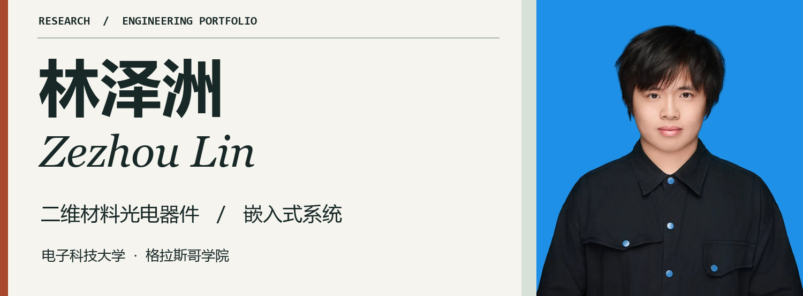
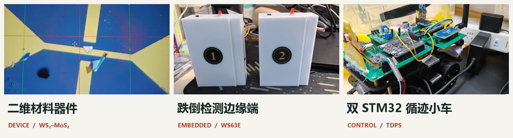
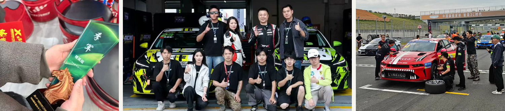

**[图文作品集 ↗](https://sugarplum202066.github.io/sugarplum202066/)**　·　[科研与工程](https://github.com/sugarplum202066/sugarplum202066/blob/main/research.md)　·　[教育与荣誉](https://github.com/sugarplum202066/sugarplum202066/blob/main/academic.md)　·　[赛道相册](https://github.com/sugarplum202066/sugarplum202066/blob/main/motorsport.md)

你好，我是林泽洲，来自广东东莞，现在在电子科技大学格拉斯哥学院读微电子科学与工程。我的本科毕设是做一台基于 WS₂/MoS₂ 异质结的计算光谱仪。我想弄清楚，同一个器件在不同偏压和栅压下的光电响应，能不能用来还原入射光谱。实验中要反复改参数、测量和导出数据，手动做一轮很耗时间，我就写了个 Python 工具，把这些步骤串了起来。

我也喜欢做嵌入式项目。2025 年，我和两位队友做了一套基于 WS63E 的居家跌倒监测系统。我担任队长，主要负责跌倒判别和主机与边缘端的通信。这个作品拿到了**全国大学生嵌入式芯片与系统设计竞赛芯片应用赛道全国总决赛二等奖**。后来做 TDPS 小车时，我主要负责双 STM32 小车的循迹控制和调试。

我已接受电子科技大学基础与前沿研究院电子科学与技术专业的硕士推免待录取通知，预计 2027 年入学。本科前六学期 GPA 为 **3.8/4.0**，大三学年学业排名 **10/160**，推免综合排名 **14/160**。

## 科研与工程

| 作品 | 我做了什么 |
| --- | --- |
| [WS₂/MoS₂ 计算光谱仪](https://github.com/sugarplum202066/sugarplum202066/blob/main/research.md#spectrometer) | 参与异质结转移、对准和器件表征，搭建可调波长测试光路。从 198 条实测 I–t 曲线中提取 508 个完整光脉冲，比较偏压、栅压与波长对光电流的影响。 |
| [4200A-SCS 光响应自动测试系统](https://github.com/sugarplum202066/sugarplum202066/blob/main/research.md#automation) | 独立开发 Python 工作台，联动 Keithley Clarius 与 NKT CONTROL。现场空载联调完成 8 组，含复位用时 16 分 30 秒，8 对 XLS/CSV 的 525 个原始数值逐项一致。 |
| [WS63E 智慧养老监测系统](https://github.com/sugarplum202066/sugarplum202066/blob/main/research.md#ws63e) [下载国赛设计报告（PDF）](https://github.com/sugarplum202066/sugarplum202066/raw/refs/heads/main/reports/ws63e-eldercare-design-report.pdf) | 担任三人团队队长，负责六轴 IMU 跌倒判别及主机、边缘端软件，通过 Wi-Fi UDP 上报告警。作品获 2025 年全国大学生嵌入式芯片与系统设计竞赛芯片应用赛道**全国总决赛二等奖**。 |
| [TDPS 双 STM32 循迹避障小车](https://github.com/sugarplum202066/sugarplum202066/blob/main/research.md#tdps) [下载 TDPS 最终报告（PDF）](https://github.com/sugarplum202066/sugarplum202066/raw/refs/heads/main/reports/tdps-group28-final-report.pdf) | 在五人团队中主导八路灰度循迹与差速 PID 调试，解决直角转弯、连续半圆后的重新捕线问题，参与整车避障联调。 |

**实验与开发工具**　二维材料干法转移、AFM 与拉曼表征、Keithley 4200 系列、Python、MATLAB、C、Linux、STM32、WS63E。

## 教育与荣誉

| 推免加权平均分 | 国赛二等奖加分 | 推免最终分 | 推免综合排名 |
| ---: | ---: | ---: | ---: |
| 87.16974 | +2.5 | **89.66974** | **14/160** |

本科期间，我连续两学年获得校级优秀学生奖学金二等奖和学院学业奖学金二等奖，也在朋辈帮学习辅导社参与组织专业课复习与保研分享。[查看课程成绩、奖学金与学生工作 →](https://github.com/sugarplum202066/sugarplum202066/blob/main/academic.md)

## 赛道内外

- **[270 cc 四小时耐力赛](https://github.com/sugarplum202066/sugarplum202066/blob/main/motorsport.md#endurance)**　2025 跨年夜，我和队友获得卡丁车四小时耐力赛精英组季军。
- **[模拟赛车](https://github.com/sugarplum202066/sugarplum202066/blob/main/motorsport.md#sim-racing)**　在电子科技大学第一届模拟赛车比赛中，以 Sugarplum 参赛，获全场第三、手柄组第一。
- **[天府国际赛车节](https://github.com/sugarplum202066/sugarplum202066/blob/main/motorsport.md#tianfu)**　从 P 房合影到发车格，记录车队在开赛前的准备。
- **[二冲竞技卡丁车](https://github.com/sugarplum202066/sugarplum202066/blob/main/motorsport.md#two-stroke)**　923 号车的一次练习中，第 9 圈跑出本场最佳 52.95 秒。相册里保留了整车和车载计时器照片。
