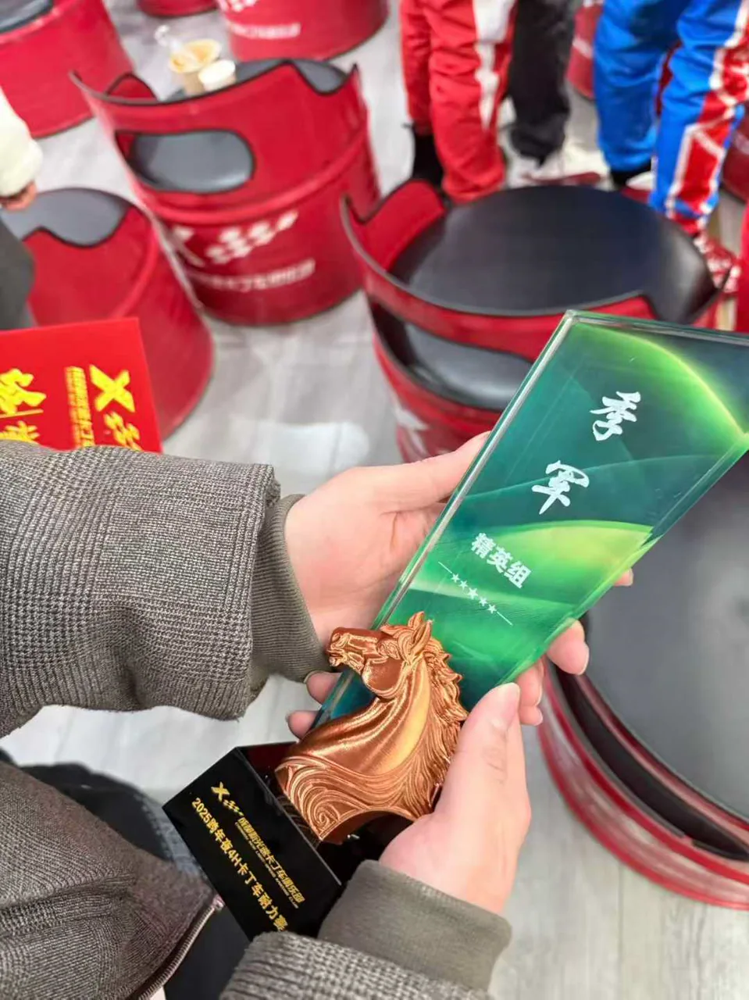
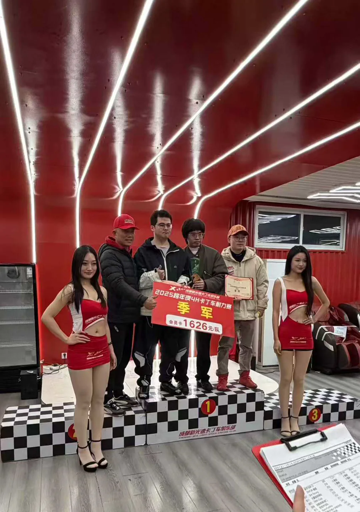
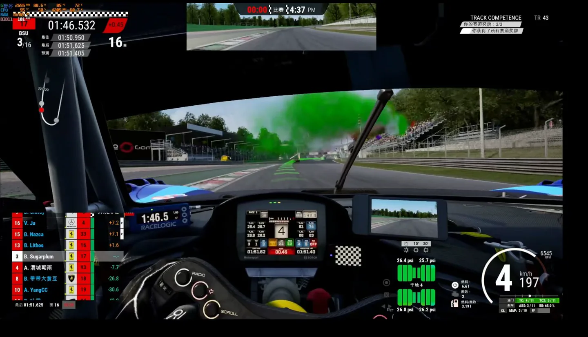
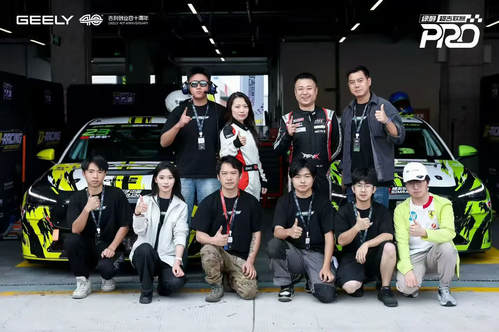
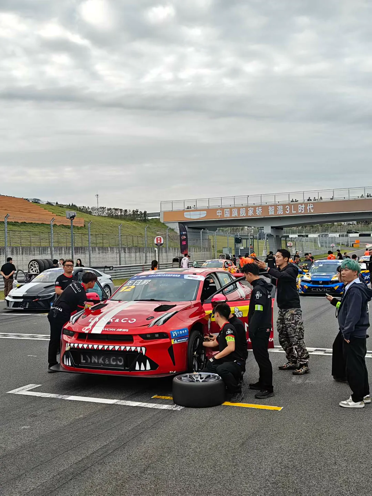
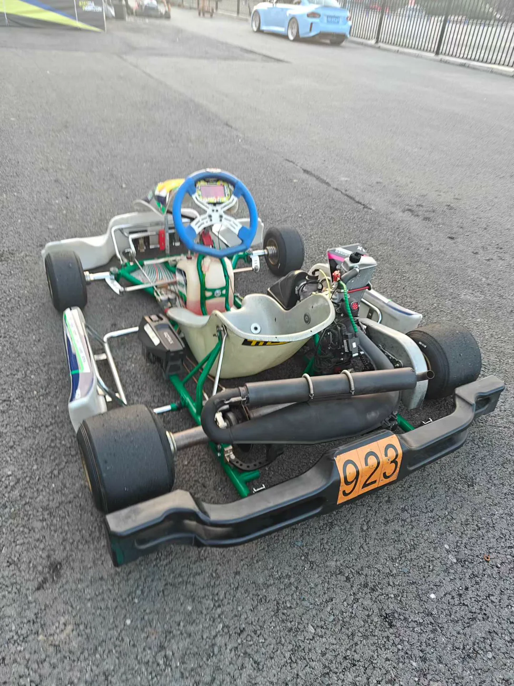
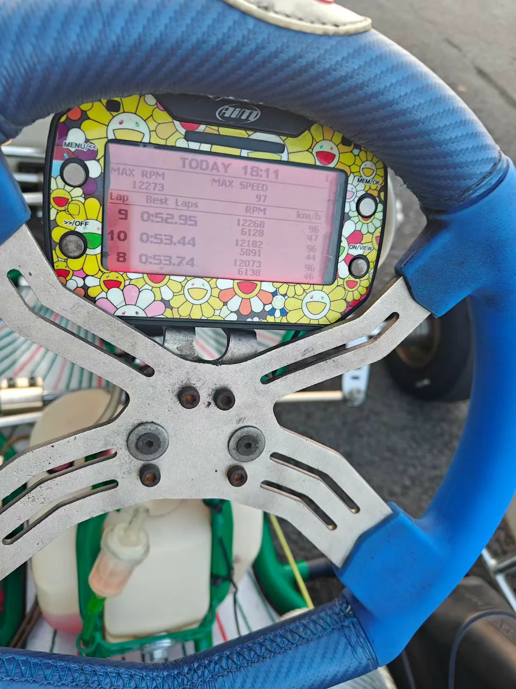
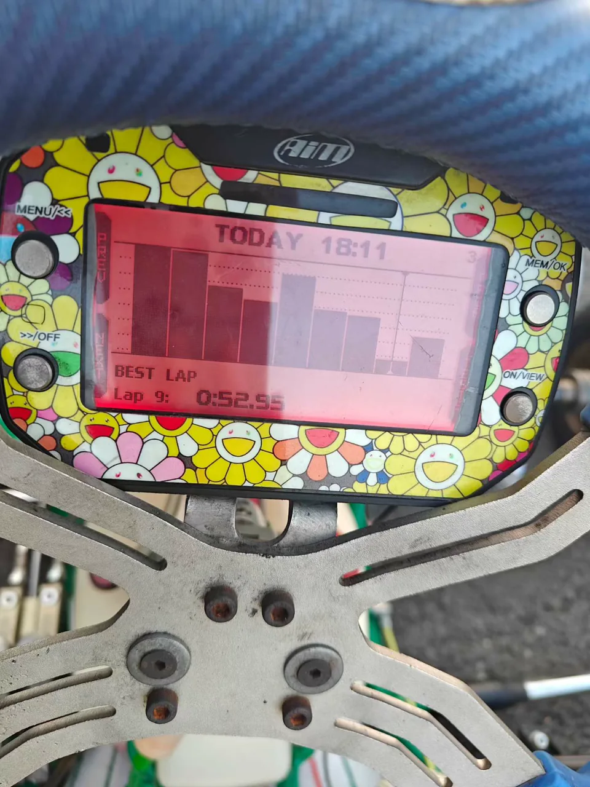

# 赛道相册

[← 林泽洲的 GitHub 主页](https://github.com/sugarplum202066)

在卡丁车耐力赛，我和队友一起领过奖。在模拟赛，我用手柄和模拟器组的选手同场比赛。这本相册也收录了二冲卡丁车练习时的圈速表，以及我在天府国际赛车节看到的发车现场。

[卡丁车耐力赛](#endurance)　·　[模拟赛车](#sim-racing)　·　[天府国际赛车节](#tianfu)　·　[二冲卡丁车](#two-stroke)

## 270 cc 卡丁车 · 四小时耐力赛

**2025 跨年夜 4H 卡丁车耐力赛，精英组团队季军。** 绿色奖杯上写着组别和名次。领奖时，我和队友一起举起了写着「季军」的颁奖牌。

| 奖杯近照 | 车队领奖 |
| :---: | :---: |
|  |  |

## 模拟赛车 · 手柄组第一

我以 **Sugarplum** 参加电子科技大学第一届模拟赛车比赛，获得**全场第三、手柄组第一**。下图是 17 号赛车的驾驶舱视角，左侧计时榜上能看到我的名字「B. Sugarplum」。

**电子科技大学赛车协会赛果公告节选**

## 天府国际赛车节 · P 房与发车区

在 P 房，两辆赛车停在合影人群身后。发车区里，12 号领克赛车已经就位，工作人员围在前轮旁，地上还放着一只车轮。

<table>
<tr><th width="67%">P 房合影</th><th width="33%">发车前的 12 号赛车</th></tr>
<tr>
<td valign="top"></td>
<td valign="top"></td>
</tr>
</table>

## 二冲竞技卡丁车 · 练习圈速

923 号车的车载仪表记录了这次练习。最快的是第 9 圈，**52.95 秒**。第 10 圈是 **53.44 秒**，两圈相差 **0.49 秒**。这次练习的最高速度为 **97 km/h**，最高转速为 **12,273 rpm**。

| 923 号二冲竞技卡丁车 | 逐圈记录 | 第 9 圈最佳圈速 |
| :---: | :---: | :---: |
|  |  |  |
