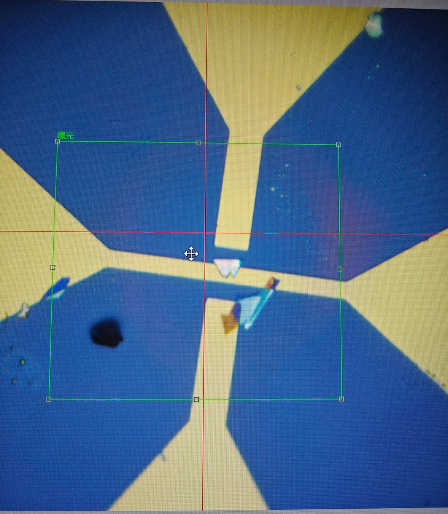
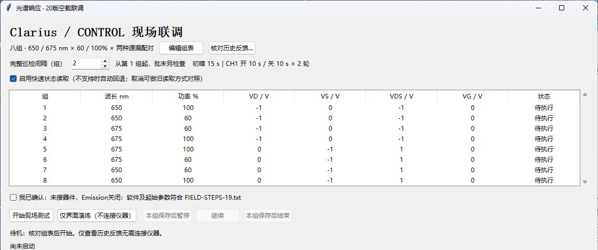
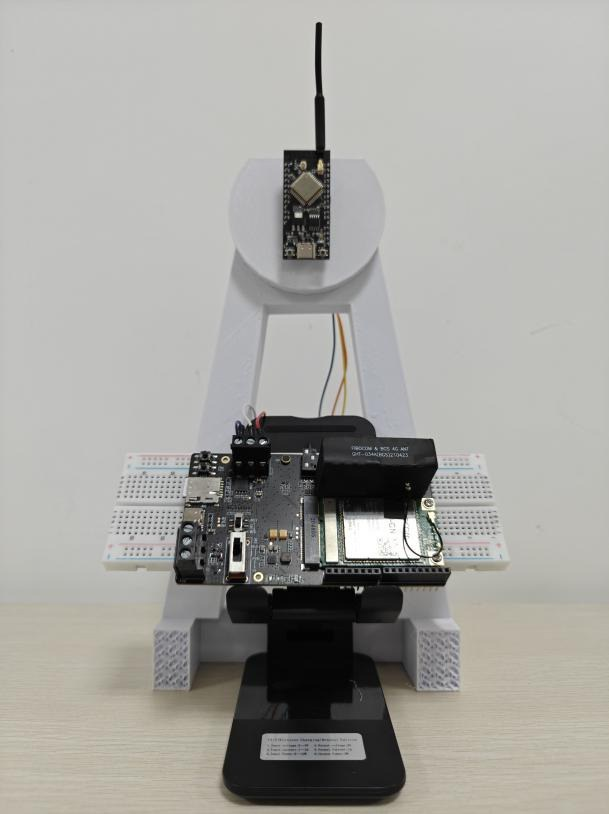
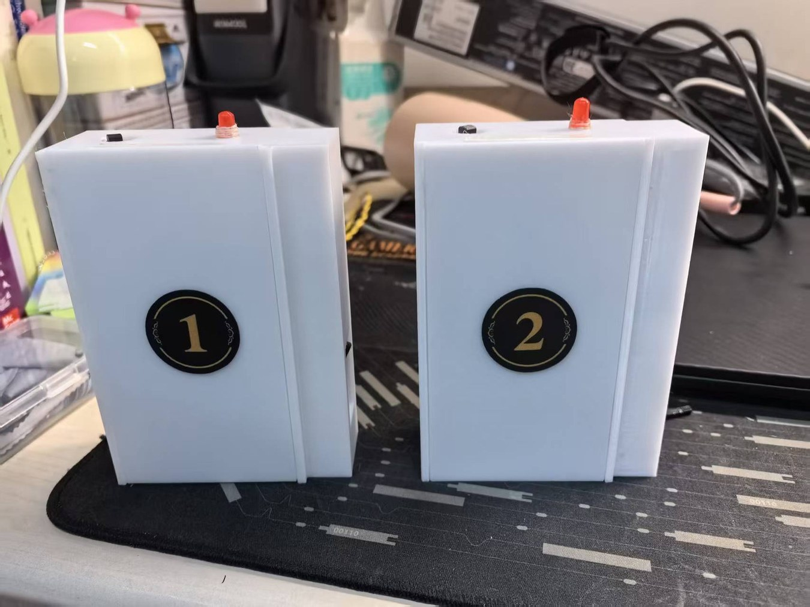
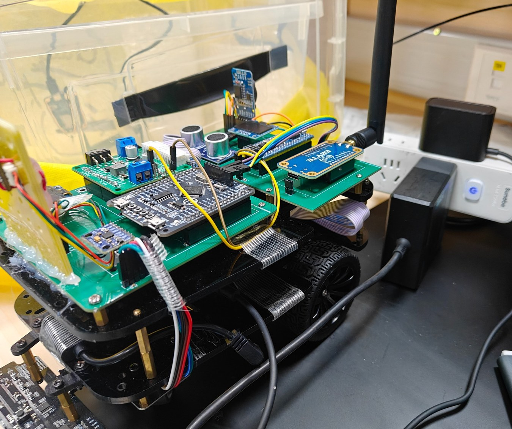
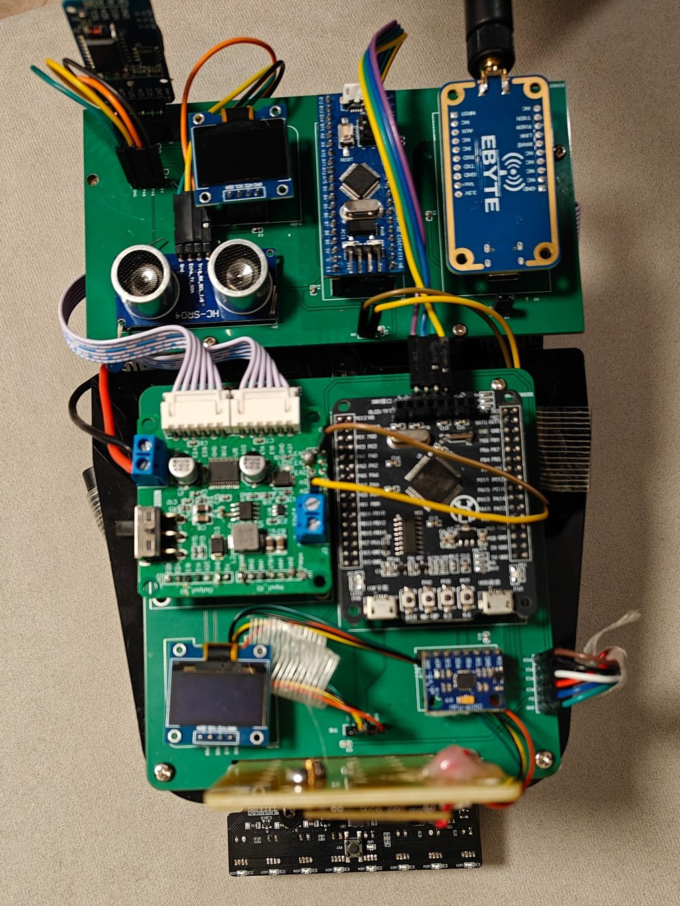

# 科研与工程作品

[返回林泽洲的主页](./README.md) · [教育与荣誉](./academic.md)

[异质结计算光谱仪](#spectrometer)　·　[仪器自动化](#automation)　·　[星闪智慧养老](#ws63e)　·　[双 STM32 小车](#tdps)

## WS₂/MoS₂ 异质结计算光谱仪

**本科毕业设计 · 2026 年 4 月起**

同一只光电器件面对不同颜色的光，都会输出电流。如果改变偏压和栅压，能否让不同波长留下足够不同的电流变化，再从这些电流推回入射光谱？这是我在本科毕设里研究的问题。

*干法转移与对准时的显微镜实拍。电极之间的区域是后续电学和光电测量的对象。*

我参与了 WS₂/MoS₂ 的干法转移、对准和初步封装，搭建可调波长光路，用 Keithley 4200 测量暗态 I–V、栅控特性及光照下的电流。随后用 Python 和 MATLAB 整理不同电学状态下的响应。

- **偏压扫描。** 将 500–900 nm 的 41 个波长与 101 个源漏偏压状态对应，扣除暗电流，得到一张 101 × 41 的光电流矩阵。交错留出部分实测波长后，比较了单峰模板匹配与正则化反演。相邻波长的曲线形状很接近，辨别相邻波长仍是难点。
- **栅压与脉冲测量。** 2026 年 11 月的三组测量共取得 198 条 I–t 曲线。从中提取 508 个完整光脉冲，用脉冲前后的暗电流修正基线，再按栅源电压和实测波长组成 11 × 7、11 × 6 和 11 × 5 三张矩阵。

接下来，我想找出能改变各波长之间相对响应的电学条件，使每次测量都能为光谱重构增加独立信息。

## 4200A-SCS 光响应自动测试系统

**个人开发 · Python / PyAutoGUI · Keithley Clarius × NKT CONTROL**

实验中，每换一组波长和偏压，都要在光源与参数分析仪的两个软件之间切换，手动导出也容易选错历史曲线。我为实验室的离线仪器电脑写了一个工作台，让每行组表对应一次采集。

*工作台的组表界面。每组保存后可以暂停，实验条件随对应的 Run 编号归档。*

程序根据源极电压与源漏电压差计算漏极电压，写入并读回三端偏压，切换光源通道，按组触发采集。导出前核对历史 Run 与结果表号，再保存原始 XLS、生成 CSV，并在批次结束时检查复位。

| 现场验证 | 结果 |
| --- | --- |
| v13、v15 同条件复测 | 相同的八组条件和开关时序下，批次耗时从 33 分 53 秒降至 28 分钟，缩短 17.3%。 |
| v19 空载联调 | 使用另一组时序，在未接器件、激光主发射关闭的条件下完成 8/8 组，含复位共 16 分 30 秒。8 对 XLS/CSV 共 75 行，525 个原始数值逐项一致。 |

## 基于 WS63E 的智慧养老监测系统

**三人团队队长 · 2025 年 1–8 月 · 全国总决赛二等奖**

[下载国赛完整设计报告（公开版 PDF，60 页）](https://github.com/sugarplum202066/sugarplum202066/raw/refs/heads/main/reports/ws63e-eldercare-design-report.pdf)

面向居家场景，我们做了一套从穿戴终端到远程告警的原型。我负责跌倒判别和 WS63E 主机、边缘终端代码。先采集站立、步行、坐起、平躺与跌倒等动作，再结合 LSM6DSL 六轴 IMU 的角速度和姿态角调试触发条件。

| 家庭主机 | 边缘终端 |
| --- | --- |
|  |  |
| 汇聚雷达数据和终端上报事件 | 在本地判断动作，通过 Wi-Fi UDP 上报 |

我参与定义终端编号、状态与 ACK 字段，设计随机发送间隔、超时重试和断线重连。我也参与了 L610 4G 模块 UART 联调，在答辩现场展示本地 Dashboard 和华为云事件上报。

在团队报告所列的典型家庭环境测试中，演示原型的跌倒检测准确率为 **≥95%**，本地报警延迟为 **≤1 秒**。Wi-Fi 在无遮挡时实测约 **20 米**、隔墙时约 **5–8 米**。系统支持一台主机管理八台终端。

## 双 STM32 自主循迹避障小车

**TDPS 课程设计 · 第 28 组 EmbedGo · 五人团队 · 2026 年**

[下载 TDPS 最终报告（PDF，11 页）](https://github.com/sugarplum202066/sugarplum202066/raw/refs/heads/main/reports/tdps-group28-final-report.pdf)

我主导循迹控制与差速 PID 调试。主控 STM32F103RCT6 读取八路灰度、编码器与 IMU，通过左右轮速差修正路径。进入直角或连续半圆后，还要判断何时结束转向、重新捕获轨迹。副控 STM32F103C8T6 配合超声、RTC 和 LoRa 完成检查点触发与计时发送。

| 整车与传感器 | 双板与接线 |
| --- | --- |
|  |  |

加装 PCB 和通信硬件后，车辆重心变化，我重新调节了出弯捕线速度和边缘纠偏参数，并参与 60 GHz 雷达避障与灰度循迹之间的模式切换联调。最终演示约 **5 分钟**走完全程，期间有 **3 次人工修正**。现场光照和胶带反射影响了十字识别与出弯重捕，也是这次课程设计最值得保留的调试经验。
